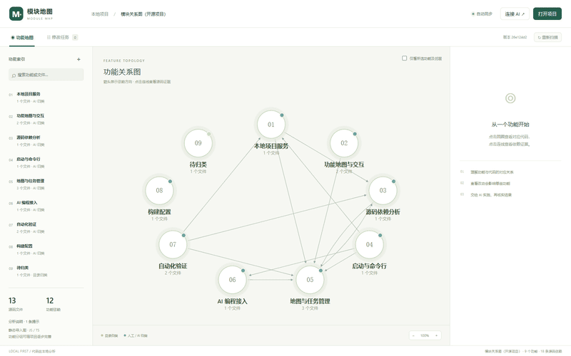

# Module Map · 模块地图

**English** · [简体中文](README.zh-CN.md)

> Your AI coding agent can read files. It can't see your architecture.
> **Module Map gives it one — built from your source, with the evidence to prove it.**

A local-first project map for AI-assisted programming. Scan a JS/TS codebase into a **feature topology**, inspect every dependency edge down to file and line, expose the whole map to AI agents over **MCP**, and verify their changes against the graph instead of taking their word for it.

[](https://github.com/yuehua-meng/module-map/stargazers)
[](LICENSE)
[](https://github.com/yuehua-meng/module-map/actions)
[](https://nodejs.org)
[](https://modelcontextprotocol.io)



## The problem

AI agents are fast at editing files and blind at architecture. They don't know that `billing` depends on `auth`, so they either touch too much or break something three modules away. The map that would answer this usually lives in a senior engineer's head, or in a diagram that went stale two sprints ago.

Module Map builds that map **from the code itself**, keeps it fresh, and hands it to the AI.

## What you get

- **Feature topology, not a hairball.** Group files into features; the graph aggregates file dependencies into feature-level relations. Grouping is editable, the dependency lines are not fakeable.
- **Evidence on every edge.** Each relation carries the referencing file, line number, specifier and target file. Click a line, read the proof.
- **AI that can actually query it.** Nine MCP tools over stdio: read the graph, read a feature, read source, propose groupings, pick up tasks, report results.
- **A closed loop for changes.** Propose a change on the canvas → AI claims the task against a baseline → AI edits and runs checks → the server re-scans and verifies the original dependency actually disappeared.
- **Local-first by design.** The server binds `127.0.0.1` only. No upload, no account, no cloud index. Your code never leaves the machine.
- **Live, quietly.** Re-scans every 3 seconds, survives Git branch switches and concurrent MCP writes.

## Quick start

Requires **Node.js 22+**.

```bash
git clone https://github.com/yuehua-meng/module-map.git
cd module-map
npm install
npm run build
npm start
```

Open <http://127.0.0.1:4317>. It scans the current directory by default — switch projects from the “打开项目” dialog.

Scan or serve any other project:

```bash
npm start -- --project "/path/to/my-app" --port 4317
npm run scan -- --project "/path/to/my-app"
```

On Windows you can also double-click `start.cmd`: it installs missing dependencies, rebuilds the UI and starts the server. Closing the window stops it.

## Connect an AI agent (MCP)

The server speaks **stdio MCP**, so it works with Codex, Claude Code, Cursor and any other MCP-compatible client.

1. Open the map, click **连接 AI** in the top-right.
2. Copy the generated config (bound to the current project).
3. Paste it into your client's MCP config and reload.

Codex (`config.toml`):

```toml
[mcp_servers.module_map]
command = "node"
args = ["/abs/path/to/module-map/node_modules/tsx/dist/cli.mjs", "/abs/path/to/module-map/packages/cli/index.ts", "mcp", "--project", "/abs/path/to/my-app"]
```

Then ask the agent to call `get_project_graph` first. A typical loop:

```text
get_project_graph  →  understand the map
save_features      →  propose business groupings (marked as AI-sourced)
create_change_task →  pick a dependency edge on the canvas
claim_change_task  →  only accepted if the baseline is still valid
report_change_result → re-scan proves the edge is gone, checks are recorded
```

Tools: `get_project_graph`, `get_feature`, `read_source`, `save_features`, `list_change_tasks`, `create_change_task`, `claim_change_task`, `report_change_result`, `cancel_change_task`.

## How it works

```text
React canvas (browser)
        │  local HTTP + session token
        ▼
apps/local-server ── packages/core ── packages/analyzer
                            ▲                 │
                            │                 ▼
                       packages/mcp       your source tree
                            ▲
                            │ stdio
                       AI coding agent
```

1. Walk the tree, apply ignore rules.
2. TypeScript AST extracts imports/exports/requires.
3. Resolve modules with the nearest `tsconfig.json` / `jsconfig.json`.
4. Record file-level evidence, aggregate to features, fingerprint the content.
5. Serve the graph; poll for changes every 3 s.

Task lifecycle:

```text
pending → in-progress → verified
                    ↘ needs-review → verified
pending / in-progress / needs-review → cancelled
```

`verified` means **the original static dependency is gone and the executor reported passing checks**. The tool re-scans before accepting the result; it does not run or certify the checks itself.

## Honest limits

- Static import graph, **not** a runtime call graph.
- Deep analysis is **JS/TS only**. Other languages are not implemented yet.
- Directory grouping is a starting point, not a confirmed business architecture.
- Framework aliases, DI containers, runtime plugin registration, DB relations and cross-language edges are not covered yet.
- Deleting a line on the canvas never deletes code.

These are declared, not hidden. See [docs/ARCHITECTURE.md](docs/ARCHITECTURE.md) for the full boundary list.

## Why not just…

| | IDE dependency graph | Architecture docs | Module Map |
|---|---|---|---|
| Survives refactors | ✅ | ❌ goes stale | ✅ re-scans |
| Feature-level view | ❌ file-level | ✅ hand-written | ✅ derived from code |
| Evidence per edge | partial | ❌ | ✅ file + line |
| Readable by AI agents | ❌ | ❌ | ✅ MCP |
| Verifies AI changes | ❌ | ❌ | ✅ re-scan |
| Stays on your machine | ✅ | ✅ | ✅ |

## Roadmap

- [ ] Language adapters (Python, Go, Java)
- [ ] File/symbol-level drill-down and large-graph layout
- [ ] Workspace packages and framework alias resolution
- [ ] Independent check runner bound to the code revision
- [ ] Launch AI tasks from the canvas with live progress
- [ ] Test coverage and change-impact analysis
- [ ] `npx module-map` one-liner distribution

## Contributing

Issues and PRs are welcome. Start with [CONTRIBUTING.md](CONTRIBUTING.md), run `npm run check` before opening a PR.

If this tool saves you an hour of archaeology, **a star helps other engineers find it** — that is the whole growth model of a project like this.

[](https://star-history.com/#yuehua-meng/module-map&Date)

## License

[MIT](LICENSE)
