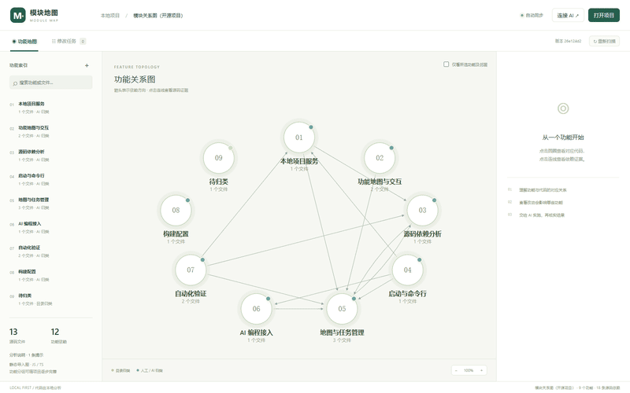

# 模块地图 · Module Map

[English](README.md) · **简体中文**

> AI 会读文件，但看不见架构。
> **模块地图把架构画出来，还附上每一根线出自哪一行代码的证明。**

一个独立于 IDE 的本地项目地图工具：把 JS/TS 源码扫描成**功能拓扑图**，每条依赖都能追到文件、行号和引用方式；再把整张图通过 **MCP** 交给 AI 编程工具；AI 改完之后，服务重新扫描源码来验证结构变化，而不是只凭它自己说“改好了”。

[](https://github.com/yuehua-meng/module-map/stargazers)
[](LICENSE)
[](https://nodejs.org)
[](https://modelcontextprotocol.io)



## 为什么需要它

AI 改代码很快，但对架构是盲的。它不知道 `billing` 依赖 `auth`，于是要么只改了表面，要么碰坏了隔了三个模块的东西。而真正能回答“谁依赖谁”的那张图，通常只存在于某位资深工程师的脑子里，或者存在于两个迭代前就已经过时的文档里。

模块地图从代码本身生成这张图，保持它是最新的，并把它交给 AI。

## 它提供什么

- **功能拓扑，而不是一团乱麻。** 把文件归到业务功能下，功能之间的连线由文件依赖聚合而成。分组可以人来改，依赖关系无法伪造。
- **每条连线都有证据。** 引用文件、行号、specifier、目标文件，点开就能核对。
- **AI 真的能查。** 9 个 MCP 工具：读整图、读功能、读源码、提议分组、领取任务、回填结果。
- **改代码形成闭环。** 在画布上选一条连线提意图 → AI 基于基线领取任务 → 改代码并跑检查 → 服务重新扫描，确认那条依赖确实消失了。
- **本地优先。** 只绑定 `127.0.0.1`，不上传、不要账号、不建云端索引，代码不出本机。
- **安静地保持同步。** 每 3 秒复扫一次，兼容 Git 切分支和独立的 MCP 进程并发写入。

## 快速开始

需要 **Node.js 22 或更高版本**。

```bash
git clone https://github.com/yuehua-meng/module-map.git
cd module-map
npm install
npm run build
npm start
```

打开 <http://127.0.0.1:4317>。默认扫描当前目录，也可以通过页面的“打开项目”切换。

```bash
npm start -- --project "/path/to/my-app" --port 4317
npm run scan -- --project "/path/to/my-app"
```

Windows 可直接双击 `start.cmd`：缺依赖会先安装，再重建页面并启动服务，关闭窗口即停止。

## 接入 AI（MCP）

服务走 **stdio MCP**，Codex、Claude Code、Cursor 以及任何兼容 MCP 的客户端都能接。

1. 打开地图，点右上角 **连接 AI**。
2. 复制为当前项目生成的配置。
3. 粘贴到客户端的 MCP 配置里，重新连接。

Codex 的 `config.toml`：

```toml
[mcp_servers.module_map]
command = "node"
args = ["/abs/path/to/module-map/node_modules/tsx/dist/cli.mjs", "/abs/path/to/module-map/packages/cli/index.ts", "mcp", "--project", "/abs/path/to/my-app"]
```

接入后的典型流程：

```text
get_project_graph    →  先让 AI 读懂这张图
save_features        →  提议业务分组，来源标记为 AI
create_change_task   →  在画布上选一条依赖线创建任务
claim_change_task    →  基线过期则拒绝领取
report_change_result →  重新扫描证明依赖消失，并记录检查结果
```

工具清单：`get_project_graph`、`get_feature`、`read_source`、`save_features`、`list_change_tasks`、`create_change_task`、`claim_change_task`、`report_change_result`、`cancel_change_task`。

## 工作原理

```text
React 浏览器画布
        │  本地 HTTP + 会话令牌
        ▼
apps/local-server ── packages/core ── packages/analyzer
                            ▲                 │
                            │                 ▼
                       packages/mcp        你的源码
                            ▲
                            │ stdio
                       AI 编程工具
```

1. 遍历目录，应用忽略规则。
2. TypeScript AST 提取 import / export / require。
3. 用最近的 `tsconfig.json` 或 `jsconfig.json` 解析模块。
4. 记录文件级证据，聚合成功能，生成内容指纹。
5. 提供图数据，每 3 秒检查一次变更。

任务状态：

```text
pending → in-progress → verified
                    ↘ needs-review → verified
pending / in-progress / needs-review → cancelled
```

“已验证”的含义是：**原始静态依赖确实消失，且执行方回填了通过的检查记录**。服务会重新扫描源码再接受结果，但它不独立执行、也不认证这些检查。

## 明确的边界

- 是静态导入图，**不是**运行时调用图。
- 深入分析**仅支持 JS/TS**，其他语言尚未实现。
- 目录归类只是起点，不等于已确认的业务架构。
- 框架别名、依赖注入、运行时插件注册、数据库关系、跨语言关系暂不覆盖。
- 图上的叉线不会删除代码。

这些都写在 [docs/ARCHITECTURE.md](docs/ARCHITECTURE.md) 里，不藏着。

## 和其他方案的区别

| | IDE 依赖图 | 架构文档 | 模块地图 |
|---|---|---|---|
| 重构后还准 | ✅ | ❌ 很快过时 | ✅ 自动复扫 |
| 功能级视图 | ❌ 只有文件级 | ✅ 手写 | ✅ 从代码生成 |
| 每条线有证据 | 部分 | ❌ | ✅ 文件 + 行号 |
| AI 能直接读 | ❌ | ❌ | ✅ MCP |
| 能验证 AI 的改动 | ❌ | ❌ | ✅ 重新扫描 |
| 数据留在本机 | ✅ | ✅ | ✅ |

## 路线图

- [ ] Python / Go / Java 语言适配器
- [ ] 文件 / 符号级下钻与大图布局
- [ ] workspace 包与框架别名解析
- [ ] 绑定代码版本的独立检查执行器
- [ ] 从画布直接启动 AI 任务并展示进度
- [ ] 测试覆盖与变更影响分析
- [ ] `npx module-map` 一行启动

## 参与贡献

欢迎 Issue 和 PR。先看 [CONTRIBUTING.md](CONTRIBUTING.md)，提 PR 前跑一遍 `npm run check`。

如果它帮你省下了一次翻代码的时间，**点个 Star 能让更多工程师看到它**——这类项目基本就靠这个传播。

[](https://star-history.com/#yuehua-meng/module-map&Date)

## 许可证

[MIT](LICENSE)
